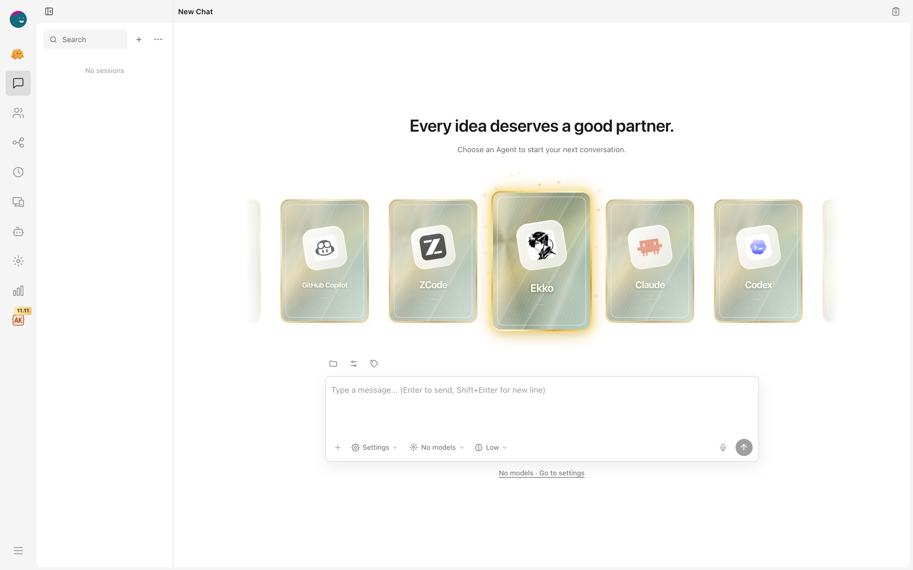
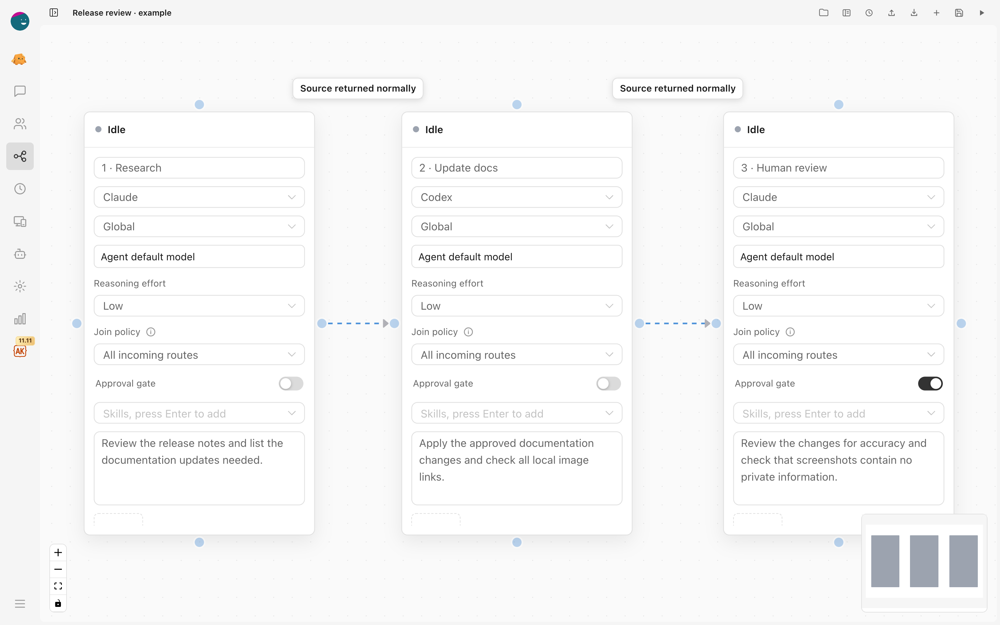
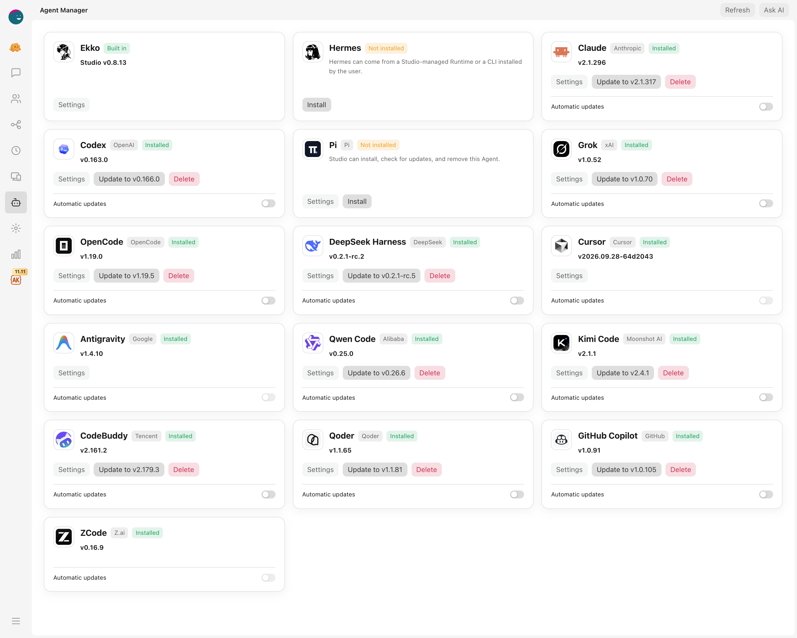

<p align="center">
  <strong>Ekko Studio</strong>
  <a href="./README_zh.md">中文</a>
</p>

<p align="center">
  A local-first AI workspace for multi-agent chat, coding, and visual workflows.<br/>
  Available as a desktop app and self-hosted web console, with support for<br/>
  <a href="https://github.com/NousResearch/hermes-agent">Hermes Agent</a>, Ekko Agent, and 14 coding-agent integrations, including Claude Code and Codex.<br/>
  Bring conversations, group collaboration, voice, files, and devices together in one place.
</p>

<p align="center">
  <a href="https://github.com/EKKOLearnAI/ekko-studio/releases/latest">Download Ekko Studio Desktop</a>
  ·
  <a href="https://ekkostudio.xyz/#/docs/getting-started">Documentation</a>
  ·
  <code>npm install -g ekko-studio && ekko-studio-web start</code>
</p>

<p align="center">
  
</p>

<p align="center">
  <a href="https://www.npmjs.com/package/ekko-studio"></a>
  <a href="https://github.com/EKKOLearnAI/ekko-studio/blob/main/LICENSE"></a>
  <a href="https://github.com/EKKOLearnAI/ekko-studio/stargazers"></a>
</p>

Ekko Studio was previously named Hermes Studio / Hermes Web UI. The GitHub
repository is `EKKOLearnAI/ekko-studio`. The primary npm package is
`ekko-studio`, with the `ekko-studio-web` command. The legacy `hermes-web-ui`
package and command remain supported and receive the same releases.

## This fork (Wizard815/hermes-studio): test branch and upgrade guide

This fork adds herdr, Pondering Orb, Mattermost, Home Assistant, Unraid and
Agent work (Vikunja tasks and approvals) on top of the newest Ekko Studio,
with its model gateway. Until it is merged into `main`, all of it lives on
one test branch, **`studio-herder`**: Studio with herdr, where chats start in
Studio and can be elevated to herdr. `main` stays as it is until
`studio-herder` has been tested on a real machine.

| Branch | What it is |
|---|---|
| `main` | Current stable build (Pondering Orb through Studio, no herdr). Unchanged until `studio-herder` is confirmed. |
| **`studio-herder`** | **Test this one.** Studio with herdr: chats start in Studio and can be elevated to herdr. Everything in this fork + newest Ekko Studio, and all of `main`'s fixes. |
| `herdr-integration` | Older version where every chat is a herdr space. Will be retired; don't start new installs on it. |

Old branches you can delete on GitHub (everything in them is already in
`studio-herder`): `herdr-separation` (renamed to `studio-herder`),
`herdr-space-folders`, `herdr-command-center`, `herdr-app-ui`,
`herdr-combined-ui`, `herdr-agents-reopen`, `recommended-plugins`,
`agent-limits`, `cleanroom-hardening`, `herdr-upstream`, `agent-work`,
`upstream-sync`, `desktop-apk` and `claude/awesome-archimedes-0x0di9`.
Delete `herdr-integration` too once `studio-herder` works for you.

### How chats use herdr

Studio and herdr are separate but work together. You start in Studio and
move a chat to herdr only when you want its agent in a terminal.

- **New chats are Studio-only.** They get no herdr space and no process.
- **Elevate to herdr**: the chat header's Elevate button, *Elevate to herdr*
  in the chat list's right-click menu, or `/herdr` in the chat box. The chat
  gets its own herdr space and its agent starts there. Messages, status,
  approvals, run limits and its folder stay in sync with Studio.
- **Return to Studio**: the chat header's menu, the right-click menu, or
  `/studio`. Its herdr space closes; the chat and its history stay.
- **The herdr page** (Chat | herdr at the top of Chats) shows only elevated
  chats and spaces you made in herdr itself. Studio's top bar is hidden there,
  so it looks like the Herdr App window; the small button at the top right
  (or Esc) brings it back.
- Agents you start in herdr itself are elevated chats too.

### Install on a Linux machine (for example an Intel NUC)

Needs Docker with the compose plugin and about 7 GB of disk.

```bash
git clone -b studio-herder https://github.com/Wizard815/hermes-studio.git
cd hermes-studio
docker compose up -d --build
docker compose logs -f hermes-webui
```

Open `http://<machine-ip>:6060`. Data is kept in `./hermes_data` (set
`HERMES_DATA_DIR` to put it somewhere else). The first login token is in the
logs and in `./hermes_data/hermes-web-ui/.token`.

To update later:

```bash
git pull && docker compose up -d --build
```

### Upgrade an existing install from `main` to `studio-herder`

1. **Back up first.** Stop Studio and copy the whole data folder: the folder
   mounted at `/home/agent/.hermes` (`./hermes_data` with compose, the
   container's appdata folder on Unraid). This copy is the surest way back.
2. **Get the branch:**
   - Compose (same checkout): `git fetch origin && git checkout studio-herder && git pull`
   - Unraid / plain Docker (new folder): `git clone -b studio-herder https://github.com/Wizard815/hermes-studio.git`
3. **Build the image** (about 5 minutes):
   - Compose: `docker compose up -d --build`
   - Unraid / plain Docker: `docker build -t hermes-studio:studio-herder .`
4. **Point the container at it** (Unraid / plain Docker only): edit the Studio
   container, set **Repository** to `hermes-studio:studio-herder`, keep the
   same data path, and apply.
5. **Add herdr's folders** so herdr keeps its spaces across restarts. Compose
   already has them. On Unraid add two paths:
   - `<appdata>/herdr/config` → `/home/agent/.config/herdr`
   - `<appdata>/herdr/state` → `/home/agent/.local/state/herdr`

Already on `herdr-integration`? Back up the same way, then
`git fetch origin && git checkout studio-herder && git pull` and rebuild
(steps 3 and 4). Your data folder and herdr folders stay as they are.

What happens on the first start:

- **herdr chats move to the new model once** (logged as "chats are Studio-only
  now"). Chats whose agent is running in herdr stay elevated. The waiting
  "press Enter" spaces of all other chats close. No chat history is touched,
  and spaces you made in herdr yourself stay. If herdr is not running yet,
  this happens the first time Studio reaches it.
- Chats, profiles, MCP servers and their tokens, Mattermost and herdr settings
  and scheduled jobs are kept.
- Each profile's model settings move onto Studio's **model gateway**: profile
  defaults become gateway routes, Hermes API key pools show on **Models → Key
  pools**, and jobs with their own model are moved onto the gateway.
- Before Studio first changes a profile, it copies Hermes's own `config.yaml`,
  `.env`, `auth.json` and `cron/jobs.json` into `<profile>/pre-studio-gateway/`
  (`<profile>` is the data folder itself for the default profile, or
  `profiles/<name>/` for the others).
- Scheduled job posts no longer carry Hermes's "Cronjob Response" header and
  "To stop or manage this job" footer. Turn them back on in **Hermes Settings →
  Session → Job post header and footer**.
- About 30 seconds after start, Studio installs and enables eight Hermes
  plugins from Hermes's plugin catalog (pinned versions), once per profile:
  agent-importers, homeassistant, langfuse, mcp-serve, bubblewrap, rea,
  print3d and gadget. It only enables them: no keys, no terminal backend
  change, no import. It also adds `hermes-chats` (mcp-serve, read-only tools)
  on the **MCP** page, and turns the Hermes Gadget platform on so devices such
  as D.A.S.H can connect to `ws://<host>:8765/gadget` after the gateway's next
  start (Docker publishes 8765; keep it on your LAN). Its status is under
  **Connections → MCU devices**. A plugin, server or platform you remove or
  turn off later stays that way. If the
  catalog cannot be reached, or Hermes is too old, Studio tries again on its
  next start. Turn it off in **Hermes Settings → Agent → Recommended Hermes
  plugins**, or set `STUDIO_RECOMMENDED_HERMES_PLUGINS=0` on the container.
  Details: [docs/hermes-integrations.md](docs/hermes-integrations.md#recommended-plugins).

### Agent work: Vikunja tasks, approvals and alerts

Agents record the work they do on your Vikunja tasks; you approve it once, in
Studio, Mattermost or Pondering Orb, and it counts everywhere. Set it up in
**Connections → Agent work → Settings**; nothing is on until you fill it in.

- **Mattermost:** run **Channels → Mattermost → Set up Mattermost** first
  (it connects the bot). Then set:
  - **Channel**: where posts go (for example `hermes`). Empty: no posts.
  - **Mention**: usernames to @mention on `#blocked` (and approval) posts.
    Empty: nobody is mentioned. Set that channel to "Mentions only" in
    Mattermost so only those alert you.
  - **Studio address for Mattermost buttons**: Studio's address as Mattermost reaches
    it (for example `http://192.168.1.10:6060`). It adds Approve / Reject
    buttons; without it, react ✅ or ❌ instead. For the buttons, also add
    Studio's IP in Mattermost under **System Console → Developer → Allow
    untrusted internal connections**.
- **ALLGlance:** its address under **ALLGlance (Vikunja tasks)** (for example `http://allglance-gateway:8090`)
  and its `GATEWAY_TOKEN`, or set `ALLGLANCE_URL` / `ALLGLANCE_TOKEN` on the
  container. Approving work linked to a Vikunja task marks the task done;
  rejecting leaves it open. If ALLGlance is down, Studio retries every 5
  minutes.
- **Pondering Orb:** connect Orb under **Connections → Pondering Orb**, then
  turn on **Share agent activity with Pondering Orb** (off by default). Orb
  needs its `agent-work` build for the Approve / Reject alerts.
- **Wiki daily digest:** the wiki REST address (Obsidian Local REST API) and API key, the daily-notes folder and the
  section name. Studio writes its part of each day's digest there.

Posts are tagged `#agentwork` plus `#working`, `#blocked`, `#approval`,
`#done`, `#approved` or `#rejected`. Once something is decided anywhere, its
Mattermost post loses its buttons, Orb's alert clears and Studio's badge goes.

API (admins): `POST /api/studio/agent-work` takes `vikunjaTaskId` or
`vikunja_task_id`, `sessionId` or `session_id`. Work an Ekko or coding-agent
chat reports without a chat id is linked to that chat. `DELETE
/api/studio/agent-work/<id>` removes a record and its activity (the Vikunja
task stays); agents have it as `ekko_studio_use_agent_work` action `delete`.

### Upstream Manager: repos, tasks and herdr agents, in tandem with Studio

[Upstream Manager](https://github.com/Wizard815/UpstreamManager) (it keeps your repos in step with
their upstreams and hands work to coding agents) shows inside Studio in the **Upstream** tab.

**Setup.** Install Upstream on the same machine (`scripts/install.sh`, or `docker compose up -d
--build`; it listens on `127.0.0.1:5001`). Then open the **Upstream** tab once. That's all: the
tab hands Upstream Studio's address and a login for you (renewed on its own), so Upstream can call
Studio back. If the tab says Upstream isn't answering, it shows the address it tried and how to fix
it. Upstream elsewhere: start Studio with `UPSTREAM_UPKEEP_TARGET=http://host:5001`, list Studio's
address in Upstream's `UPSTREAM_TRUSTED_PROXIES`, and set `HERMES_STUDIO_URL_FOR_UPSTREAM` to how
that machine reaches Studio.

**herdr: one herdr, two apps.** On Studio's machine Upstream starts its agents through Studio's
herdr bridge, not on its own:

- Each agent a task gets (Hermes by default) is a normal Studio chat in its own herdr space, with
  Studio's models, profile and folders, filed in the Studio folder named after the repo if there is
  one. It works in the task's own branch folder.
- The chat's header shows **Upstream task**; it opens the task in the Upstream tab (its branch,
  the proposed commit message, the approval).
- Studio tells Upstream when the agent starts working, waits for an answer, finishes, or its pane
  closes, the same way it tells Pondering Orb about Orb work. You answer the agent in Studio or in
  herdr.
- Neither app closes the other's herdr spaces. Agents on other machines (`herdr --machine`) are
  started by Upstream's own herdr connection, and Upstream falls back to that here too if Studio
  can't start one. Set `UPSTREAM_HERDR_VIA_STUDIO=off` in Upstream's `.env` to never go through Studio.

**Moving between them.** A link in Upstream to a Studio chat opens the chat in Studio. Links to
`#/hermes/upstream?path=/work?task=<id>` open an Upstream page, and Studio's address follows the
page Upstream shows, so reloads and the back button keep your place.

| Variable | Default | Description |
| --- | --- | --- |
| `UPSTREAM_UPKEEP_TARGET` | `http://127.0.0.1:5001` | Where Upstream Manager listens. |
| `UPSTREAM_UPKEEP_PATH_PREFIX` | `/upstream` | The path Studio serves it under. |
| `HERMES_STUDIO_URL_FOR_UPSTREAM` | `http://127.0.0.1:<PORT>` | How Upstream reaches Studio (only when Upstream runs on another machine). |

### Going back to `main`

`main` has not changed, so its image still works with your backup.

Easiest: stop Studio, put the backup from step 1 back, check out `main`
(`git checkout main`) and rebuild, or point the container back at your old
`main` image.

Without the backup: stop Studio, copy the files in each
`<profile>/pre-studio-gateway/` back into that profile (`cron-jobs.json` goes
back to `cron/jobs.json`), then start the `main` image. If you skip the copy,
the old build opens but no model works. herdr spaces stay in herdr's folders;
`main` ignores them.

### What to check after upgrading

Things the automated tests could not cover, because they need a real model or
your own services:

- [ ] A chat streams a reply and uses a tool
- [ ] `/model` switches the model in a chat and in herdr
- [ ] A job with its own model runs and posts to Mattermost (without the header and footer)
- [ ] Home Assistant and Unraid tools answer through Hermes
- [ ] Key pools switch to the next key on a real rate limit
- [ ] Hermes local works with a downloaded model (if you use it)
- [ ] Old chats, jobs and Mattermost still work as before
- [ ] Connections → Pondering Orb connects, and Orb work starts a Studio chat
- [ ] Agent work: approve one item from each of Studio, Mattermost and Orb; the Vikunja task is marked done
- [ ] A new chat stays in Studio: no herdr space appears for it
- [ ] herdr: elevate a Hermes chat (`/herdr`), send a message, restart the container, and check the pane is still linked
- [ ] herdr: `/studio` on that chat closes its herdr space and the chat keeps its messages
- [ ] Watcher: a denied approval shows in the bell; Trust this lets the next run through without asking ([docs/watcher.md](docs/watcher.md))
- [ ] Home Assistant: "turn on the kitchen light" in a Hermes chat asks first; Trust this with `light.*` lets the next one run ([docs](docs/hermes-integrations.md#home-assistant-actions-ask-first))
- [ ] A new Hermes chat answers within about 10 s with the recommended plugins (rea) installed
- [ ] Gadget: from a Studio Hermes chat, "show 'hello' on my gadget" shows a card on the device
- [ ] herdr: on a new install, elevating a Claude Code chat opens the chat, not Claude Code's theme or API key questions

Known issues on this branch:

- A reply that is still being written when Studio restarts is lost without a note.
- A full disk shows only "Internal Server Error" (files are not damaged).
- With gateway autostart off, Hermes can still start its own gateway for chats.


## Screenshots

Captured from **v0.8.13** source on 2026-11-03, running locally with isolated data. The workflow is an example created in the UI and has not been run; Agent statuses reflect this machine. See [capture notes](./docs/screenshots/overview/README.md).

| Visual workflows | Agent Manager |
| --- | --- |
| [](./docs/screenshots/overview/workflow.png) | [](./docs/screenshots/overview/agent-manager.png) |
| Connect agent steps and add a human approval gate; this example is not running. | Manage Agent installations, settings, and updates in one place. |

## Core Capabilities

| Area | What Ekko Studio does |
| --- | --- |
| Multi-agent runtime | Connects the agents listed below with streaming responses, tool traces, generated-file previews, persistent sessions, and standalone desktop chat windows. |
| Studio workspace | Provides shared chats, group chat, global-agent runs, workflows, files, voice, media, devices, themes, logs, usage, and App connectivity across agent runtimes. |
| Agent control planes | Keeps Hermes profiles, providers, models, memory, skills, plugins, jobs, Kanban, channels, and runtime management in their owning agent module. |
| Automation | Builds executable visual workflows and connects the supported runtimes through schedules, approval gates, group-chat rooms, platform channels, and MCP servers. |
| Workspace tools | Provides a file browser, web terminal, Desktop Agent Browser, screenshot capture, voice input/output, coding-agent runners, device discovery, Journey graph, and performance views. |
| Distribution | Ships as a desktop app for Windows/macOS/Linux, an npm CLI package, and a Docker image. |

## Supported Agents

Single chat, group chat, and workflows share the same Agent catalog. Coding agents run on the machine hosting the Studio backend; their CLI must be installed there.

| Agents | Configuration and installation |
| --- | --- |
| Ekko Agent, Hermes Agent | Ekko is built in. Desktop and Docker bundle a Hermes runtime; npm installations discover an existing Hermes installation. |
| Claude Code, Codex, Pi, Grok, OpenCode, DeepSeek Harness (DSH) | Studio-scoped or native global configuration; installation and supported updates through Agent Manager. |
| Qwen Code, Kimi Code, CodeBuddy, GitHub Copilot CLI, ZCode | Studio-scoped or native global configuration. ZCode requires manual installation; the others support npm installation through Agent Manager. |
| Cursor, Qoder, Antigravity | Cursor and Qoder use native global configuration. Antigravity supports scoped and global launches. Cursor and Antigravity require manual installation. |

Scoped mode uses isolated session configuration; supported runtimes can use the selected Studio provider/model. Global mode uses the CLI's existing configuration and sign-in. Available models, tools, and context controls depend on the runtime.
See [native coding agents](./docs/native-coding-agents.md), [Antigravity CLI](./docs/antigravity-cli.md), and [DSH setup](./docs/dsh-management.md) for details.

## Features

### AI Chat

- Start a conversation from responsive Agent cards; Ekko is the initial default, and Studio remembers the last agent, model, workspace, launch mode, and reasoning options
- Real-time chat streaming over Socket.IO `/chat-run`; Studio dispatches each run to the selected runtime adapter
- Multi-session management — create, rename, delete, switch between sessions
- **Self-built session database** — local SQLite storage for Studio sessions; Hermes state.db remains a read-only source for Hermes history APIs
- Session grouping by source (Telegram, Discord, Slack, etc.) with collapsible accordion
- Active session indicator — live sessions pin to top with spinner icon
- Sessions sorted by latest message time
- Markdown rendering with syntax highlighting and code copy
- Tool call detail expansion (arguments / result)
- Profile-scoped file uploads, clipboard image/file paste, and workspace attachments
- File download support — download uploaded files and agent-generated files by resolved path across local, Docker, SSH, and Singularity backends
- Inline previews for generated HTML, PDF, DOCX, PPTX, XLSX, CSV, images, Markdown, and source files
- Session search — Ctrl+K search across the Studio local session database; read-only Hermes history sessions are not included
- Session categories, message references, compression progress, and durable background delegation results
- Persistent task cards with live step progress, approval prompts, and clarification questions
- Profile-aware model selector with runtime-specific provider/model availability
- Per-turn token usage, cache hits, estimated cost, and generation speed; supported runtimes also expose context usage and compression controls

### Platform Channels

Unified configuration for **10 platforms** in one page:

| Platform      | Features                                                               |
| ------------- | ---------------------------------------------------------------------- |
| Telegram      | Bot token, mention control, reactions, free-response chats             |
| Discord       | Bot token, mention, auto-thread, reactions, channel allow/ignore lists |
| Slack         | Bot token, mention control, bot message handling                       |
| WhatsApp      | Enable/disable, mention control, mention patterns                      |
| Matrix        | Access token, homeserver, auto-thread, DM mention threads              |
| Feishu (Lark) | App ID / Secret, mention control                                       |
| DingTalk      | Client ID / Secret, mention control                                    |
| QQBot         | App ID / Secret, mention control                                       |
| WeChat        | QR code login (scan in browser, auto-save credentials)                 |
| WeCom         | Bot ID / Secret                                                        |

- Credentials and channel behavior settings write to `.env` and `config.yaml` under the selected Hermes profile
- Per-platform configured/unconfigured status detection
- Gateway autostart is opt-in under Hermes settings; ordinary Studio chat does not require a platform Gateway

### Usage Analytics

- Total token usage breakdown (input / output)
- Session count with daily average
- Estimated cost tracking & cache hit rate
- Model usage distribution chart
- 30-day daily trend (bar chart + data table)

### Scheduled Jobs

- Create, edit, pause, resume, delete cron jobs
- Trigger immediate execution
- Cron expression quick presets

### Kanban

- Profile-aware Kanban board for planning and tracking agent work
- Task creation, updates, and status movement from the dashboard
- Uses the Hermes Kanban CLI and its task storage, with Studio authentication and profile access controls

### Visual Workflows

- Vue Flow canvas for the supported Agent catalog, with file/image attachments and runtime-specific launch settings
- Directed edges, structured conditions, success/failure routes, loops, and approval gates
- Import/export for portable workflow definitions and profile-aware workspaces
- Run budgets, deadlines, stop/rerun controls, and persisted execution history
- Frozen run snapshots, node conversations, edge decisions, and evidence playback on the canvas

### Model Management

- Auto-discover models from credential pool (`~/.hermes/auth.json`)
- Fetch available models from each provider endpoint (`/v1/models`)
- Add, update, and delete providers (preset and custom OpenAI-compatible)
- OAuth/device flows for OpenAI Codex, Nous Portal, xAI, Claude, and GitHub Copilot
- Provider URL auto-detection for non-v1 API versions (e.g. `/v4`)
- Provider-level model grouping, visible-model controls, aliases, refresh, and default switching
- Separate STT and TTS provider catalogs under Models

### Multi-Profile

- Create, rename, delete, and switch between Hermes profiles
- Clone existing profile or import from archive (`.tar.gz`)
- Export profile for backup or sharing
- Profile-scoped configuration, cache, uploads, sessions, jobs, usage, memory, skills, plugins, providers, and model visibility
- Account-bound profile access: super administrators can manage every profile; regular administrators only see and use profiles assigned to their account

### File Browser

- Browse files on remote backends (local, Docker, SSH, Singularity)
- Upload, download, rename, copy, move, and delete files
- Store uploaded files under the selected/requested Hermes profile while keeping downloads path-based for agent-generated artifacts outside the upload directory
- Create directories
- Preview and edit supported files with syntax highlighting, then attach workspace files back to a chat

### Group Chat

- Multi-agent chat rooms with real-time messaging via Socket.IO
- @mention routing — mention an agent to trigger a contextual reply
- Context compression — automatic conversation summarization when history exceeds token threshold
- Typing status and reply progress indicators
- Room creation, deletion, and invite code management
- Agent management — add/remove agents from rooms with per-agent profiles
- SQLite message persistence
- Mobile responsive with collapsible sidebar

### Coding Agents

- Detect, configure, launch, and monitor the 14 coding-agent integrations listed above; install and update supported CLIs from Agent Manager
- Built-in coding-agent terminal, session history, workspace selection, images, and file diffs
- Dedicated proxy routes and API modes for provider/model compatibility
- Standalone desktop chat windows and persisted output/reasoning metadata
- Shared `~/.agents/skills` entries are read-only in Coding Agent pages; runtime-specific settings, private skills, and MCP controls vary by agent

#### DeepSeek Harness (DSH)

- Use DSH in single chats, group-chat rooms, and workflow nodes, with Studio-selected providers/models or native global configuration.
- Select an Agent preset when creating a chat, adding a group member, or configuring a workflow node; resumed conversations retain their selected preset.
- Reuse the native `web` profile’s plugins. **Plugin configuration** embeds the plugins’ own settings UI with light/dark theme support; **Plugin list** manages installed packages. Agent presets have a separate Studio management page.
- Manage DSH settings, instructions, MCP, and private skills. Shared `~/.agents/skills` entries are display-only in every Coding Agent page; editing and deletion are blocked.

Install DSH on the machine running the Studio backend through Agent Manager. Native plugin installation requires `pnpm` on that machine’s PATH. See [DSH setup, profiles, and compatibility](docs/dsh-management.md) for details.

### Desktop Agent Browser

- Desktop-only multi-tab browser that agents can navigate through the managed MCP server
- Isolated browser profiles, per-tab control leases, proxy settings, downloads, cookies, and permissions
- Accessibility snapshots, screenshots, console logs, and page annotations for agent-assisted browsing
- Bounded page queries and sequential action batches, with observations of changed text, selected values, and newly opened tabs

### Mobile App & Session Sharing

- Connect the App over LAN, authenticated direct transport, or cloud relay, with relay fallback when a direct connection is unavailable
- Follow single-chat, group-chat, and workflow progress through task cards and notifications; supported iOS builds also show Live Activities
- Share a single conversation with an App account, configure its input/file/voice/terminal permissions, and revoke access
- Use persistent terminal sessions from the App

See [App connectivity](./docs/app-relay.md) and [session sharing](./docs/session-share-tokens.md) for setup and permission boundaries.

### JEV Evaluation

- Profile-scoped evaluation settings for memory recall, skill matching, and learning
- Optional browser-action, group-chat, and workflow assessments with independent controls

See [JEV configuration and integration status](./docs/jev.md).

### Skills & Memory

- Browse and search installed skills
- View skill details and attached files
- Install and manage Skill Bundles with profile-aware usage statistics
- User notes, persistent Ekko Agent memory, and profile-scoped memory management
- Interactive Journey graph for skill/memory relationships, category filtering, detail inspection, and playback

### Theme Customization

- Light/dark mode, interface style, base font size, text color, and active color
- Per-account background images and live preview across the workspace

### Logs

- View agent / server / error logs
- Filter by log level, log file, and keyword
- Structured log parsing with HTTP access log highlighting

### Admin & Runtime Management

- Device and LAN peer views for local-network discovery and peer tooling
- MCP manager for the managed `ekko-studio-*` servers, profile injection, and `api` / `browser` / `devices` / `use` / `plan` toolsets; task plans and clarification use the dedicated `ekko-studio-interaction` server
- Runtime version and version-preview tooling for testing newer builds in isolation
- Performance monitor views for super administrators

### Authentication

- Token-based auth (auto-generated on first run or set via `AUTH_TOKEN` env var)
- Username/password login with account management in Settings
- Default bootstrap credentials are `admin` / `123456`; users are prompted after login to change the default username and password
- Super administrators can manage users and profile bindings; regular administrators can manage their own account details

CLI maintenance commands:

```bash
# Delete persisted login IP lock records
ekko-studio-web clear-login-locks

# Delete login locks and restart the running Studio server
ekko-studio-web clear-login-locks --restart

# Create or reset the default super administrator login to admin / 123456
ekko-studio-web reset-default-login
```

`clear-login-locks` removes `${HERMES_WEB_UI_HOME:-~/.hermes-web-ui}/.login-lock.json`. If the server is running, restart it to clear in-memory lock state. `reset-default-login` updates the Studio account database; if an `admin` user already exists, its password is reset to `123456` and the account is enabled as a super administrator.

### Settings

- Display (streaming, compact mode, reasoning, cost display)
- Agent (max turns, timeout, tool enforcement)
- Memory (enable/disable, char limits)
- Session reset (idle timeout, scheduled reset)
- Privacy (PII redaction)
- Model settings (default model & provider)
- Profile and provider configuration

### Voice / TTS / STT

- Manage voice providers under Models → STT and Models → TTS; existing Settings → Voice links redirect there.
- TTS adapters: Edge, OpenAI-compatible, MiMo, Doubao, ElevenLabs, Gemini, xAI, Mistral, MiniMax, and DeepInfra.
- STT adapters: Browser, OpenAI-compatible, Doubao, Groq, Mistral, xAI, ElevenLabs, and DeepInfra.
- Use editable turn-based voice input from the chat mic, or open the full-screen real-time voice stage for a continuous voice-focused experience.
- Provider keys and MiMo voice-clone audio stay server-side; the browser receives only masked secret status.
- Starting a new voice turn stops current assistant playback first, but does not implicitly cancel an active agent run.
- For supported settings, security notes, and current non-goals, see [`docs/voice-dialogue.md`](./docs/voice-dialogue.md).
- The real-time stage does not claim simultaneous full-duplex listen/speak; telephony and always-on wake-word listening remain out of scope.

### Web Terminal

- Integrated terminal powered by node-pty and @xterm/xterm
- Multi-session support — create, switch between, and close terminal sessions
- Real-time keyboard input and PTY output streaming via WebSocket
- Window resize support

### Desktop App & Updates

- Native Electron shell for Windows, macOS, and Linux
- Bundles the Studio runtime and starts the local server automatically
- Capture a screen region, annotate it, and attach it to single or group chat; configure an optional global screenshot shortcut
- Hide Studio during capture on supported Windows/macOS setups; Linux capture uses X11 or the system Screenshot Portal according to the desktop environment
- Uses Cloudflare download endpoints for desktop auto-update metadata and assets first
- Falls back to GitHub Releases `latest` assets if the Cloudflare update feed is unavailable
- Windows upgrades attempt to close an existing Ekko Studio process before replacing files

---

## Quick Start

### Desktop App (Recommended)

Download the latest **Ekko Studio** desktop installer from
[GitHub Releases](https://github.com/EKKOLearnAI/ekko-studio/releases/latest).

Desktop builds are published for macOS, Windows, and Linux, with separate
architecture assets where applicable. The desktop app bundles the Studio
runtime and stores Hermes Agent data in `~/.hermes` on Windows, macOS, and Linux.

The desktop wrapper stores its own Studio state separately in
`~/.hermes-web-ui` unless `HERMES_WEB_UI_HOME` is set.

After the packaged desktop app starts, it installs managed command shims so the
desktop app, bundled Hermes Agent CLI, and bundled server CLI do not conflict:

| Command | Description |
| --- | --- |
| `ekko-studio` | Open the Ekko Studio desktop app |
| `ekko-studio cli ...` | Run the bundled Hermes Agent CLI |
| `ekko-studio web ...` | Run the bundled `hermes-web-ui` command |
| `ekko-studio -h` | Show wrapper help |
| `ekko-studio-mcp [api\|browser\|devices\|use\|plan]` | Run one managed Studio MCP toolset |

The desktop command is `ekko-studio`; the previous managed `hermes-studio`
command is removed when the new shim is installed. No compatibility alias is created.

Use `ekko-studio cli -h` for Hermes Agent CLI help and
`ekko-studio web -h` for server CLI help. `ekko-studio-mcp` defaults to the
`api` toolset; choose `browser`, `devices`, `use`, or `plan` to keep the exposed MCP
surface focused on the current task.

Desktop auto-updates read the latest feed from
`https://download.ekkolearnai.com/latest` first. If that endpoint is
unavailable, the updater falls back to
`https://github.com/EKKOLearnAI/ekko-studio/releases/latest/download`.

### npm

```bash
npm install -g ekko-studio
ekko-studio-web start
```

The legacy package `hermes-web-ui` continues to receive the same releases.
Both packages expose `ekko-studio-web` and the existing commands. Install either
package; their global command aliases overlap. To switch, uninstall the old
package before installing the other. User data remains in `~/.hermes-web-ui`.

Open **http://localhost:8648**

Requires Node.js **23 or newer**. Ekko Agent is included; to use Hermes Agent, install its runtime on the same machine or use the bundled Desktop/Docker distribution.

### Docker Compose

Single-container deployment with integrated Hermes Agent:

```bash
# Use pre-built image (Recommended)
WEBUI_IMAGE=ekkoye8888/hermes-web-ui docker compose up -d

# Or build from source
docker compose up -d --build

docker compose logs -f hermes-webui
```

Open **http://localhost:6060**

- Persistent Hermes data is stored in `./hermes_data`
- Studio auth token is stored in `./hermes_data/hermes-web-ui/.token`
- On first run with auth enabled, the token is printed to container logs
- All runtime settings are environment-variable driven in `docker-compose.yml`

For detailed notes and troubleshooting, see [`docs/docker.md`](./docs/docker.md).

### Hermes Agent Runtime Discovery

When Studio starts backend chat features, it prefers a source checkout that
contains `run_agent.py` such as `~/.hermes/hermes-agent`. If no source checkout
is found, it falls back to the Python environment used by the installed
`hermes` command, then the system Python. This supports both source installs
and package installs such as `pip install hermes-agent`.

## Studio Environment Variables

These variables configure Ekko Studio, its local Hermes runtime integration, and development/preview helpers. Provider API keys and Hermes Agent settings are normally managed through Hermes profiles; environment variables here are process-level overrides.

| Variable | Default | Description |
| --- | --- | --- |
| `PORT` | `8648` | Studio server listen port. |
| `BIND_HOST` | `0.0.0.0` | Studio server bind host. Set `::` explicitly for IPv6. |
| `HERMES_LAN_ADVERTISE_URL` | unset | Reachable Studio origin used in App LAN QR codes. Set this to the Docker host's LAN URL when Studio is opened through `localhost`, for example `http://192.168.1.20:6060`. |
| `HERMES_APP_ENTITLEMENT_REQUIRED` | `true` | Require a valid cloud-signed App entitlement before accepting a LAN App relay connection. Set `false` only for temporary compatibility diagnostics. |
| `HERMES_APP_ENTITLEMENT_PUBLIC_KEY` | built in | Optional PEM public-key override for RS256 App entitlements. The expected issuer is `hermes-studio-server` and audience is `ekko-studio`. |
| `HERMES_WEB_UI_HOME` | `~/.hermes-web-ui` | Studio data home for auth token, credentials, logs, DB, and default uploads. `HERMES_WEBUI_STATE_DIR` is also supported as a compatibility alias. |
| `HERMES_WEBUI_STATE_DIR` | unset | Compatibility alias for `HERMES_WEB_UI_HOME`. |
| `HERMES_WEB_UI_DISABLE_MCP_AUTOINJECT` | unset | Disable startup injection of the managed `ekko-studio-*` MCP servers into Hermes profile configs. |
| `HERMES_WEB_UI_ALLOW_TRANSIENT_MCP_AUTOINJECT` | unset | Allow managed MCP injection when `HERMES_WEB_UI_HOME` is under a temporary directory, such as Version Preview runtimes. |
| `UPLOAD_DIR` | `$HERMES_WEB_UI_HOME/upload` | Upload root override. Files are stored below profile-scoped subdirectories. |
| `CORS_ORIGINS` | same host only | Comma- or space-separated cross-origin allowlist for HTTP, Socket.IO, and WebSocket requests. Set `*` only when you intentionally need legacy wildcard CORS. |
| `AUTH_TOKEN` | auto-generated | Explicit bearer token. If unset, Studio creates one under `HERMES_WEB_UI_HOME`. |
| `AUTH_JWT_SECRET` | `AUTH_TOKEN` | JWT signing secret override for username/password sessions. |
| `HERMES_WEB_UI_AUTH_JWT_EXPIRES_IN` | `30d` | Username/password session JWT lifetime. Accepts seconds or `s`/`m`/`h`/`d` suffixes, for example `12h` or `7d`. |
| `PROFILE` | `default` | Startup/default Hermes profile. Runtime requests use the profile selected by the frontend and authorized for the current account. |
| `LOG_LEVEL` | `info` | Server log level. |
| `BRIDGE_LOG_LEVEL` | `$LOG_LEVEL` or `info` | Bridge log level. |
| `MAX_DOWNLOAD_SIZE` | `200MB` | Maximum file download size. |
| `MAX_EDIT_SIZE` | `10MB` | Maximum editable file size. |
| `WORKSPACE_BASE` | current user's home directory | Base directory for workspace browsing. |
| `HERMES_HOME` | `~/.hermes` | Hermes data home on Windows, macOS, and Linux. |
| `HERMES_BIN` | `hermes` | Custom Hermes CLI binary path. |
| `HERMES_AGENT_ROOT` | auto-discovered | Hermes Agent source checkout containing `run_agent.py`. |
| `HERMES_AGENT_BRIDGE_PYTHON` | auto-discovered | Python interpreter used to launch the agent bridge. |
| `HERMES_AGENT_BRIDGE_UV` | auto-discovered | `uv` executable used to launch the agent bridge when available. |
| `UV` | auto-discovered | Fallback `uv` executable path. |
| `PYTHON` | auto-discovered | Fallback Python executable for the agent bridge. |
| `HERMES_AGENT_BRIDGE_ENDPOINT` | platform default | Agent bridge broker endpoint. Windows defaults to `tcp://127.0.0.1:18765`; macOS/Linux defaults to `ipc:///tmp/hermes-agent-bridge.sock`. |
| `HERMES_AGENT_BRIDGE_TIMEOUT_MS` | `120000` | Timeout for Node requests to the bridge broker. |
| `HERMES_AGENT_BRIDGE_CONNECT_RETRY_MS` | `5000` | Short retry window for connecting to the bridge socket. |
| `HERMES_AGENT_BRIDGE_STARTUP_TIMEOUT_MS` | `120000` | Timeout while waiting for the Python bridge to become ready. |
| `HERMES_DSH_READY_TIMEOUT_MS` | `180000` | DSH configuration helper startup/readiness budget in milliseconds, including its native authentication/frontend probes. Set a positive integer up to `2147483647`; invalid values use the default. For slower plugin-heavy starts, use e.g. `360000`. The two per-request probe timeouts stay at 5 seconds. |
| `EKKO_STUDIO_DSH_ACP_TIMEOUT_MS` | `60000` | Per-request budget for DSH ACP initialization, session creation/restoration and configuration. For slow starts, use e.g. `240000`. Prompt generation has no request timeout; session close keeps its separate 10-second budget. Compatibility alias: `HERMES_DSH_ACP_TIMEOUT_MS`. |
| `EKKO_STUDIO_ACP_TIMEOUT_MS` | `60000` | Independent per-request budget for other native ACP agents' initialization, session creation/restoration and model/effort selection. Prompt generation has no request timeout. Compatibility alias: `HERMES_ACP_TIMEOUT_MS`. |
| `EKKO_STUDIO_AGENT_MODEL_DISCOVERY_TIMEOUT_MS` | `20000` | Total deadline for each native model-discovery subprocess, across all request/response exchanges, independent of both ACP chat request budgets. For slow discovery, use e.g. `240000`. An explicit internal `timeoutMs` override takes precedence over both environment names. Compatibility alias: `HERMES_AGENT_MODEL_DISCOVERY_TIMEOUT_MS`. |
| `HERMES_AGENT_BRIDGE_STOP_ON_SHUTDOWN` | enabled | Stop the bridge broker during Studio shutdown and restart. Set `0`, `false`, `no`, or `off` to keep the bridge across restarts. |
| `HERMES_AGENT_BRIDGE_AUTO_RESTART` | enabled | Auto-restart the bridge broker after unexpected exit. Set `0`, `false`, `no`, or `off` to disable. |
| `HERMES_AGENT_BRIDGE_RESTART_DELAY_MS` | `1000` | Base delay for bridge auto-restart backoff. |
| `HERMES_AGENT_BRIDGE_PLATFORM` | `cli` | Platform identity passed to Hermes Agent. |
| `HERMES_AGENT_BRIDGE_WORKER_TRANSPORT` | platform default | Profile worker transport. Set `tcp` for loopback TCP or `ipc`/`unix` for Unix domain sockets; defaults to Windows TCP and macOS/Linux IPC. |
| `HERMES_AGENT_BRIDGE_WORKER_PORT_BASE` | `18780` | Base port for TCP worker endpoints. |
| `HERMES_BRIDGE_PROVIDER` | profile/default | Provider override for bridge runs. |
| `HERMES_BRIDGE_TOOLSETS` | profile/default | Toolset override for bridge runs. |
| `HERMES_BRIDGE_MAX_TURNS` | profile/default | Maximum turn override for bridge runs. |
| `HERMES_BRIDGE_SUPPRESS_PLATFORM_HINT` | `cli` | Controls bridge platform hint suppression passed to Hermes Agent. |
| `HERMES_OPENROUTER_APP_REFERER` | `https://ekkostudio.xyz` | OpenRouter attribution referer sent by bridge runs. |
| `HERMES_OPENROUTER_APP_TITLE` | `Ekko Studio` | OpenRouter attribution title sent by bridge runs. |
| `HERMES_OPENROUTER_APP_CATEGORIES` | `cli-agent,personal-agent` | OpenRouter attribution categories sent by bridge runs. |
| `HERMES_WEB_UI_MANAGED_GATEWAY` | enabled | Controls Studio-managed Hermes gateway process handling. Set `0`, `false`, `no`, or `off` to use `hermes gateway start` instead. |
| `HERMES_WEB_UI_DISABLE_GATEWAY_AUTOSTART` | unset | Override the opt-in Hermes Gateway autostart policy. Set `1`, `true`, `yes`, or `on` to disable startup checks and configuration-driven reconciliation even when enabled in settings. |
| `HERMES_WEB_UI_DISABLE_SKILL_INJECTION` | unset | Skip startup bundled skill injection. Set `1`, `true`, `yes`, or `on` when bundled skills are managed outside Studio. When injection is enabled, Studio updates only skills it previously installed or identical existing bundled copies; local edits and user-owned same-name skills are skipped. |
| `HERMES_WEB_UI_STOP_GATEWAYS_ON_SHUTDOWN` | off (on in the desktop app) | By default the gateway Studio supervises keeps running when Studio shuts down, and the next Studio adopts it without restarting it. Set `1` or `true` to stop it on shutdown instead. Gateways Studio did not launch are never adopted or stopped. |
| `HERMES_WEB_UI_SHUTDOWN_FORCE_EXIT_MS` | `10000` | Short cleanup budget before Studio force-stops its owned process trees and exits. |
| `HERMES_DESKTOP_STOP_TIMEOUT_MS` | `20000` | Desktop host's existing outer deadline before it force-stops the complete Web UI process tree; independent from the Web UI's 10-second cleanup budget. |
| `HERMES_GATEWAY_URL` / `GATEWAY_URL` | unset | Explicit Hermes gateway upstream URL for proxy routes. |
| `GATEWAY_HOST` | `127.0.0.1` | Default Hermes gateway upstream host for proxy routes. |
| `GATEWAY_PORT` | `8642` | Default Hermes gateway upstream port for proxy routes. |
| `HERMES_WEB_UI_PREVIEW_REPO` | package repository | GitHub repository used by Version Preview. |
| `HERMES_WEB_UI_PREVIEW_AGENT_BRIDGE_TRANSPORT` | platform default | Version Preview broker transport. Set `tcp` to use loopback TCP for Preview on macOS/Linux; when unset, Preview follows `HERMES_AGENT_BRIDGE_WORKER_TRANSPORT=tcp`. |
| `HERMES_WEB_UI_PREVIEW_AGENT_BRIDGE_ENDPOINT` | isolated preview endpoint | Directly overrides the Version Preview broker endpoint. |
| `HERMES_WEB_UI_BACKEND_PORT` | `8648` | Backend port used by the Vite dev proxy. |
| `HERMES_WEB_UI_FRONTEND_PORT` | `8649` | Frontend Vite dev server port. |

For the three `EKKO_STUDIO_*_TIMEOUT_MS` settings above, Studio uses the first
valid value: the new name, then its `HERMES_*` compatibility alias, then the
listed default. Values are converted with `Number` and must be integer
milliseconds in `1..2147483647`; missing, empty, zero, negative, fractional,
non-finite or overflowing values are skipped. This preserves legacy numeric
parsing (including surrounding whitespace, scientific notation and hexadecimal).
The old names remain supported; existing `HERMES_DSH_READY_TIMEOUT_MS`, state
paths, authentication and Hermes Agent settings are unchanged. The new prefix
identifies these budgets as Studio-owned Coding Agent settings.

Set them in the **Studio server process environment** and restart the server.
For npm, for example: `EKKO_STUDIO_DSH_ACP_TIMEOUT_MS=240000 ekko-studio-web restart`.
For Desktop, fully quit the app and launch it with the variables in its environment;
remote Desktop clients must configure the remote server. Adding them only to a
Hermes profile's `.env` or to an agent subprocess does not configure Studio's
parent-process timers. The supplied [Docker Compose setup](docs/docker.md)
forwards both new and legacy names from the shell or Compose `.env`; recreate the
container after changing them. With `docker run`, pass them explicitly using `-e`.

### CLI Commands

`hermes-web-ui` remains an alias for the `ekko-studio-web` commands below.

| Command | Description |
| --- | --- |
| `ekko-studio-web start [port]` | Start in background; accepts a positional port or `--port <port>` |
| `ekko-studio-web client [port]` | Start for a remote client with gateway autostart disabled and permissive CORS |
| `ekko-studio-web restart [port]` | Restart; stops the bridge by default |
| `ekko-studio-web stop` | Stop the background process |
| `ekko-studio-web status` | Check if running |
| `ekko-studio-web clear-login-locks [--restart]` | Clear persisted login locks, optionally restart |
| `ekko-studio-web reset-default-login` | Create or reset the default administrator login |
| `ekko-studio-web update` / `upgrade` | Update to the latest version and restart |
| `ekko-studio-web version` / `-v` | Show the version |
| `ekko-studio-web -h` | Show help |
| `hermes-web-ui-mcp [api\|browser\|devices\|use\|plan]` | Run one managed Studio MCP toolset (same as `ekko-studio-mcp`) |

Add `--no-open` to `start` or `client` when no browser should open.

`restart`, `update`, and `upgrade` stop the Agent Bridge broker by default so restarted or updated servers do not reuse stale Python bridge processes. Set `HERMES_AGENT_BRIDGE_STOP_ON_SHUTDOWN=0` before restarting only when you explicitly want to keep the bridge broker and running bridge sessions alive.

`update` / `upgrade` first attempt `npm cache clean --force`, then install the latest version of the running package (`ekko-studio@latest` or `hermes-web-ui@latest`) and restart that package. The Web UI version check uses the same package identity. Cache cleanup is best-effort; if it fails, the updater continues with the install.

### Auto Configuration

On startup the BFF server automatically:

- Initializes Studio data directories, local databases, and bundled skills
- Starts the Hermes agent bridge when a Hermes runtime is available; Gateway autostart follows the opt-in Hermes setting
- Opens a browser on successful startup unless `--no-open` is set

---

## Development

```bash
git clone https://github.com/EKKOLearnAI/ekko-studio.git
cd ekko-studio
npm install
npm run dev
```

- Frontend: http://localhost:8649
- BFF Server: http://localhost:8647

```bash
npm run harness:check
npm run test
npm run build   # outputs to dist/
```

See [DEVELOPMENT.md](./DEVELOPMENT.md) for contributor commands and
[ARCHITECTURE.md](./ARCHITECTURE.md) for the complete package and state model.

## Architecture

```text
Browser / Desktop / App
          │ HTTP + Socket.IO
          ▼
Koa bootstrap (composition only)
          │
          ├─ Studio platform ── chat, groups, global agent, workflows,
          │                    sessions, files, voice, devices, webhooks
          ├─ Hermes family ─── profiles, models, skills, memory, jobs,
          │                    Kanban, channels, terminal, Hermes bridge
          ├─ Ekko family ───── Ekko runtime and agent-owned services
          └─ Coding family ─── coding-agent adapters, scoped config, native CLI execution
```

The server is organized by business ownership under
`packages/server/src/modules/{studio,hermes,ekko,coding-agents}`. Routes stay
thin, controllers own HTTP concerns, services own reusable behavior, and only
`packages/server/src/bootstrap` may compose concrete modules and adapters.
Cross-agent code belongs to Studio; an agent module must not absorb a shared
product surface merely because it uses that agent today.

Studio state and Hermes Agent state remain separate. Studio defaults to
`~/.hermes-web-ui`; Hermes profile data remains under the Hermes home. For the
full ownership tree, dependency rules, and API migration contract, see
[`docs/harness/server-module-boundaries.md`](./docs/harness/server-module-boundaries.md).

## Tech Stack

**Frontend:** Vue 3 + TypeScript + Vite + Naive UI + Pinia + Vue Router + vue-i18n + SCSS + markdown-it + highlight.js

**Backend:** Koa 2 + Socket.IO + SQLite + node-pty

## License

[BSL-1.1](./LICENSE)

The license covers Ekko Studio, the `hermes-web-ui` npm package and CLI,
desktop applications, firmware, release
artifacts, documentation, and associated files in this repository.

The MCP entry point is `bin/ekko-studio-mcp.mjs`; tools use the `ekko_studio_*` prefix. Existing `hermes-studio-mcp` / `hermes-web-ui-mcp` commands and `hermes_studio_*` calls remain compatible. Restart the MCP client to discover the new tool names. Studio migrates managed server configurations to `ekko-studio-api`, `ekko-studio-browser`, `ekko-studio-devices`, `ekko-studio-use`, and `ekko-studio-interaction`.

## Privacy

Read the [Privacy Notice](PRIVACY.md) before configuring providers, agents or integrations.
