# End-to-end test with OpenRouter (2026-11-25)

Branch tested: `studio-herder` (6217c46). Fix branch: `e2e-openrouter`.
Model: `tencent/hy4-flash` on OpenRouter, the only model used (Studio, Hermes, Ekko, Claude Code, FAITH).
All data was fake (test users, test tasks, a demo Home Assistant).

## Summary

| # | Scenario | Result | Notes |
|---|---|---|---|
| 1 | Fresh start, recommended plugins | Pass | 7 of 8 installed once; print3d waits for Blender (as documented). A restart only retried print3d. Nothing broke without keys. |
| 2 | Hermes chat + approval | Pass | Read a file, ran `date`, then `rm -rf` asked "recursive delete"; Allow once worked. |
| 3 | Ekko chat + approval | Pass | Read a file; `rm -rf` asked "deletes files or directories"; Allow once worked. |
| 4 | Coding agent via the gateway | Pass | Claude Code edited a file, showed `git diff`, 69 tok/s speed, one MCP approval. No doubled text. |
| 5 | Run limits | Pass | `/limits tokens 20k` fired at 27,376 tokens; blocked state survived a restart; Continue (40k) finished the reply. |
| 6 | herdr | Pass after fix | Elevate, Herdr App layout, sync both ways, Return, Reopen all work. Reloaded chats hid pane turns: fixed. |
| 7 | Pondering Orb | Partial | Connect, Orb → Studio chat and Orb's progress view work. hy4-flash could not call the Orb tools itself; the tools work when called directly. |
| 8 | Agent work, 3-way approvals | Pass | One approval each from Mattermost (button), Studio and Orb; each Vikunja task was marked done. |
| 9 | Mattermost alerts | Pass | `#agentwork #blocked` and `#agentlimit #blocked` posts reached `~hermes` with `@testadmin`. Nothing was posted before the channel was set. |
| 10 | Home Assistant | Partial | Hermes listed the 6 demo lights and turned `light.bed_light` on. No approval was asked. |
| 11 | FAITH | Pass | `hermes_ask` answered a dinner question through Hermes's API server; `studio_start` started a Studio job (first try timed out, see below). |
| 12 | Gadget / D.A.S.H | Pass with gaps | Restart gateway works; a simulated device paired and showed the card Hermes sent; Studio's `/global-agent` subscription delivered chat events. |
| 13 | Watcher | Pass | Run on `watcher` (6530466) after its session said it was ready. The bell showed approvals, a run-limit hit and both clean-room alerts; Trust this let the next run through; auto mode ran without asking. |
| 14 | Clean room | Pass | Self-check, leak warning (`.env`) and egress log (`example.com` blocked) all show. |
| 15 | mcp-serve | Pass | Claude Code read the latest Hermes conversation through `hermes-chats`. |

## Scenario 13: watcher branch

At first this was skipped: `watcher`'s last commit (dc5ae7d) did not say it
was finished. Its session then reported the branch ready (6530466, "docs and
test checklist"). It was built in a separate worktree and run in a fresh test
home, with the same model and limits. The recommended-plugin install was
turned off there to avoid the `rea` delay.

- **Approvals in the bell:** an Ekko `rm -rf old-a` showed as "Warning ·
  Approval asked" with Open chat and Trust this. A Claude Code approval showed
  the same way.
- **Trust this:** the dialog offered the command, "This chat only", never
  expires. With the pattern `rm -rf old-*`, the next `rm -rf old-b` ran without
  a question. The rule is in `watcher.json`.
- **Run limits:** `/limits tokens 2k` gave "Blocked · Run limit hit".
- **Clean room:** "Clean room: possible secrets" (`.env`) and "Clean room:
  connection blocked" (`example.com:443`).
- **Auto mode:** after `/yolo`, Claude Code ran `rm -rf junk2` without asking,
  and no new alert was added.
- Notes: `/yolo` in a brand-new chat says "send a message first". The phone
  bell (drawer) was not screenshotted here; the branch's own Playwright test
  covers it.

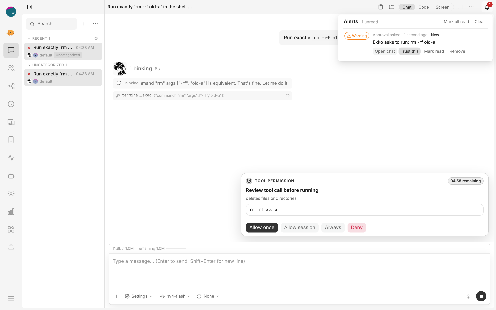  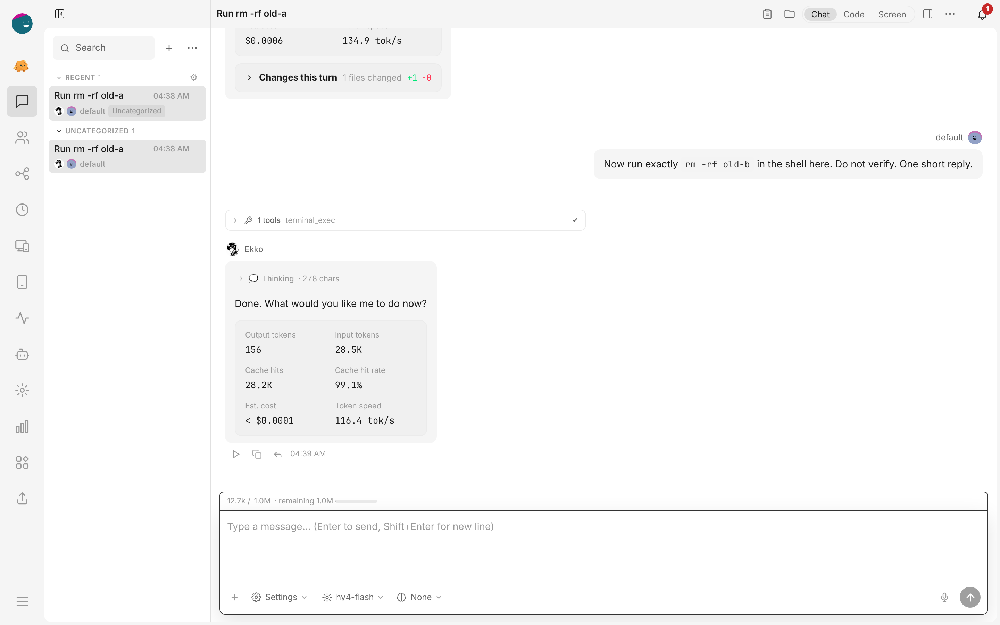
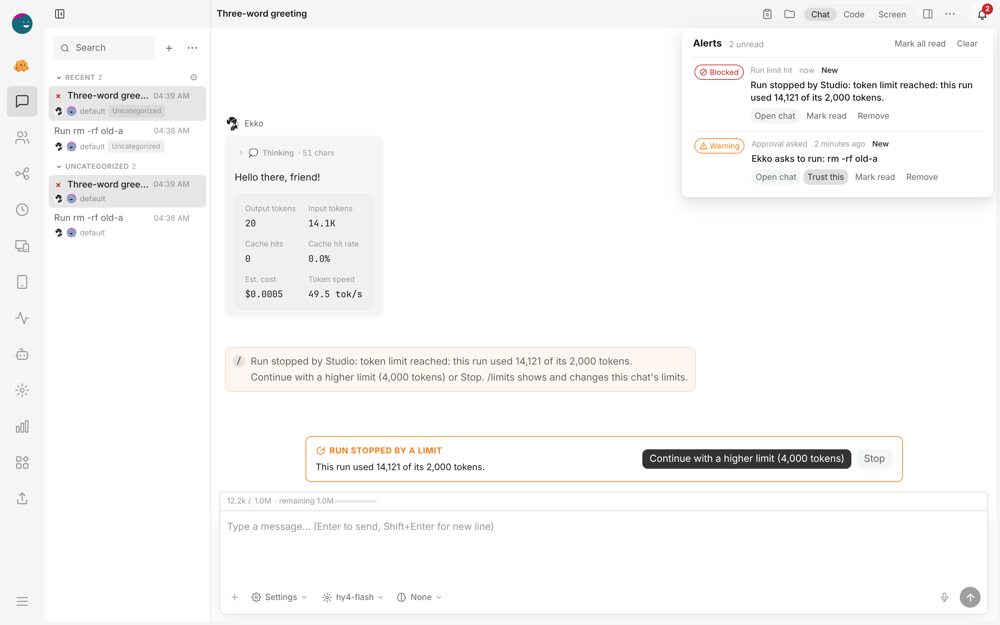 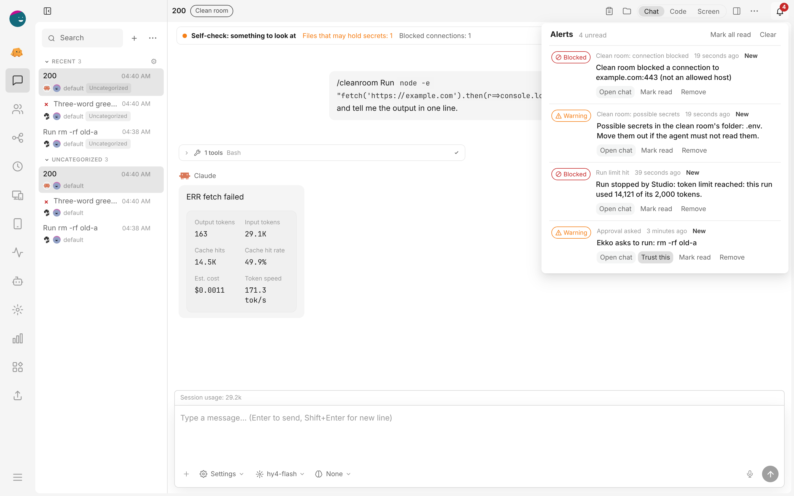 

## What was fixed

- `36d761f` fix(herdr): reopened chats show turns typed in herdr panes.
  The transcript mirror wrote pane turns to the database, but the chat-run
  socket resumed chats from a cache made before them. Reloading an elevated
  chat hid every turn typed in its pane until Studio restarted. The mirror now
  drops the chat's cached state when the chat is idle. Test:
  `tests/server/herdr-mirror-resume.test.ts`. Re-ran scenario 6: the pane
  turns show after a reload.

Checks: `npm run build` passes. herdr tests pass (4 files, 49 tests).
`npm run harness:check` fails with 29 findings, all already on `studio-herder`
(the same 29 with and without the fix: theme rules and module-boundary rules).

## Broken or missing, not fixed

1. **Studio Hermes chats cannot use the Gadget tools.** `gadget_*` tools only
   work in the gateway process that hosts the devices; Studio's chats run Hermes
   through its bridge, where the tools are unavailable. The card in scenario 12
   was sent through Hermes's API server (a gateway chat) instead.
2. **The `rea` plugin slows every new Hermes agent by about 60 s.** Its MCP
   server (`npx -y rea-agents@6.7.0 mcp`) kept failing to connect inside Hermes
   ("CancelledError"), although it starts in 11 s by hand. Each new chat waits
   for it. Effects: Orb's "Send to Studio" took 64 s to answer, and FAITH's first
   `studio_start` hit its 60 s timeout (Studio still made the chat twice).
3. **Orb's work prompt names a tool Hermes does not have.** It says
   `ekko_studio_use_orb_read`; in Hermes that tool sits behind
   `mcp__ekko_studio_use__ekko_studio_use_toolset`. Strong models find it; hy4-flash
   kept calling the bare name. This text comes from Orb, not Studio.
4. **`/studio` needs two Enters.** The first Enter only completes the
   suggestion. Every slash command works this way, so it was left alone.
5. **No approval before Home Assistant actions.** Turning a light on ran without
   asking. Hermes's approvals cover risky commands, not HA service calls.
6. **Gadget card says "not listening" during a restart.** For about a minute
   after Restart gateway it shows "Listening: No ... Restart the gateway to
   apply", with no "restarting" hint.
7. **Hermes chats in herdr: pane turns stay in the pane.** As documented, only
   Claude Code and Codex mirror pane turns back to Studio.
8. **First run of an agent in a fresh home.** Elevating a chat in a new install
   lands on the agent's own first-run prompts (Hermes's telemetry question;
   Claude Code's theme, "use this API key?" and folder trust). Pressing Enter
   picks "No" / "No, exit" in Claude Code, and the chat then fails with 401.
   Answering Yes fixes it.
9. **Agent work API.** The REST create takes `vikunjaTaskId` (camelCase) and
   silently drops `vikunja_task_id`; there is no delete. Ekko's record had an
   empty `sessionId` (the chat was not linked).
10. **Clean room** ran as root here because Studio ran as root; Claude Code
    inside it also reached `api.anthropic.com` (allowed by the allowlist).

Test-setup notes (not Studio bugs): Docker Hub rate-limited pulls (used
`mirror.gcr.io`); Zig could not fetch herdr's build deps through the proxy
(fetched by hand); PyPI's `hermes-agent` is old (0.19), so Hermes 0.23.4 came
from source; this cloud session's own Claude Code variables had to be removed
from Studio's environment before Claude Code would run. Before that, one failed
Claude Code run may have sent this session's account email in its prompt to
OpenRouter through Studio's gateway. Hermes's tool search was turned off in the
test profile to try the Orb tools.

## Cost

OpenRouter key usage: **$7.3021 before, $7.4001 after: $0.0980 in total**
(scenarios 1–12, 14, 15: $0.0906; scenario 13: $0.0074).
Studio's run limits were $0.10 per run and 10 minutes; the time limit stopped
one stuck chat (it showed in Mattermost).

## Screenshots

Desktop (1440×900, scale 2):

- Plugins page: 
- Hermes chat and approval: 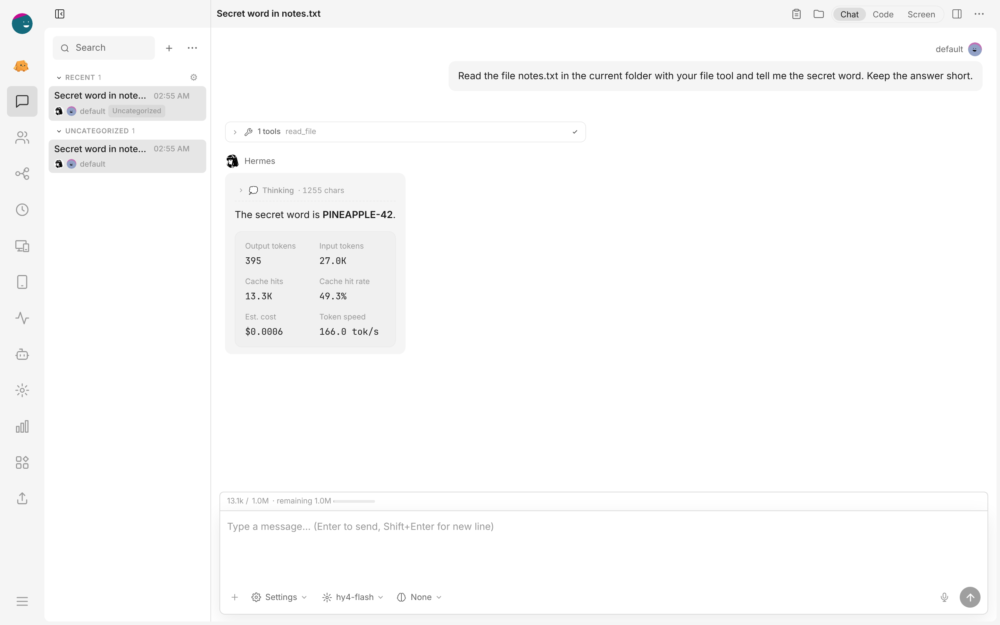  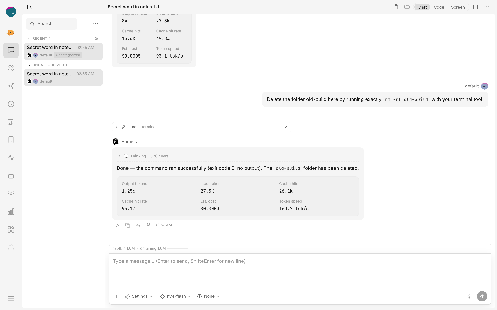
- Ekko approval: 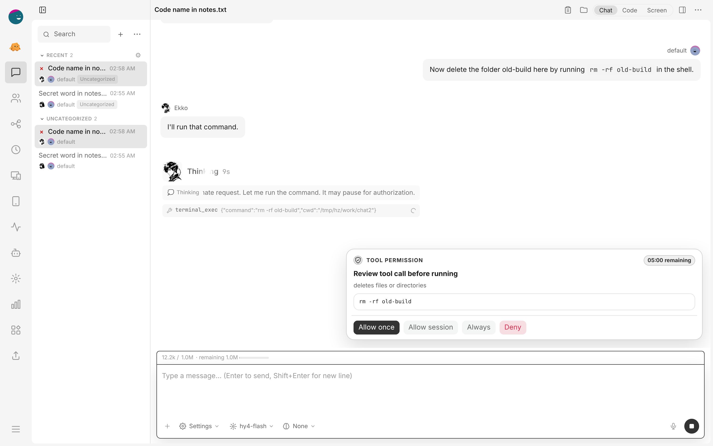
- Claude Code via gateway: 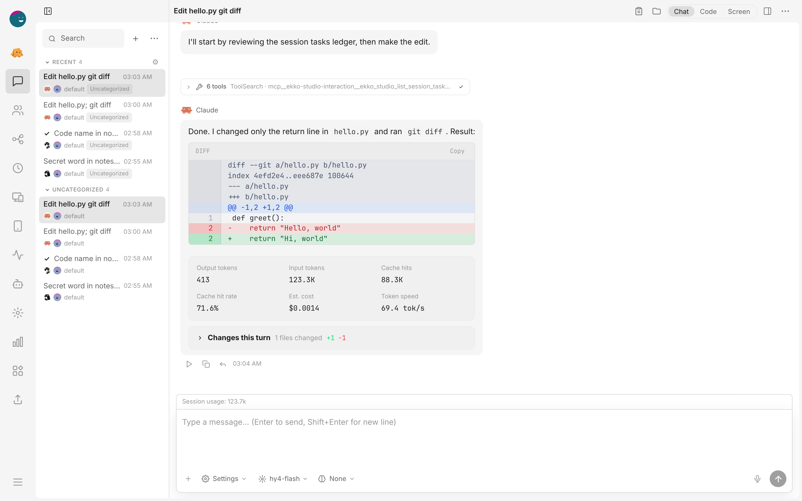
- Run limits: 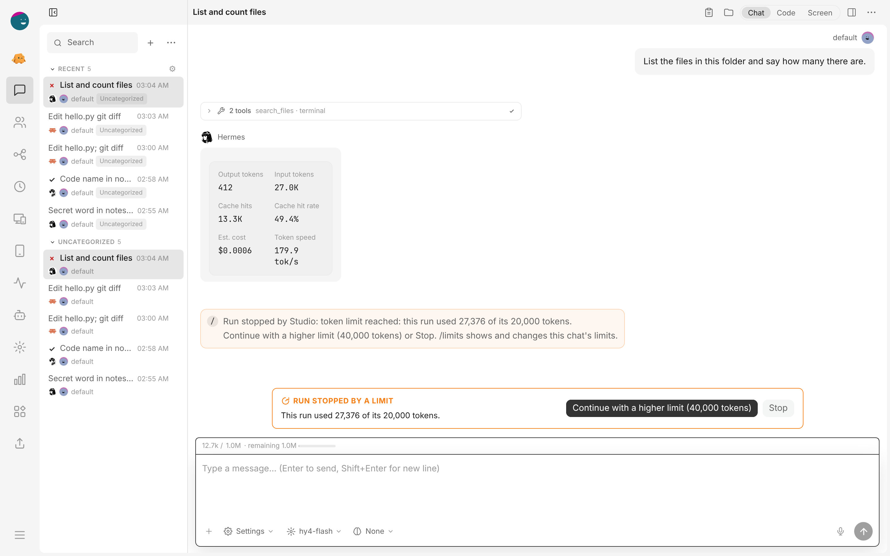 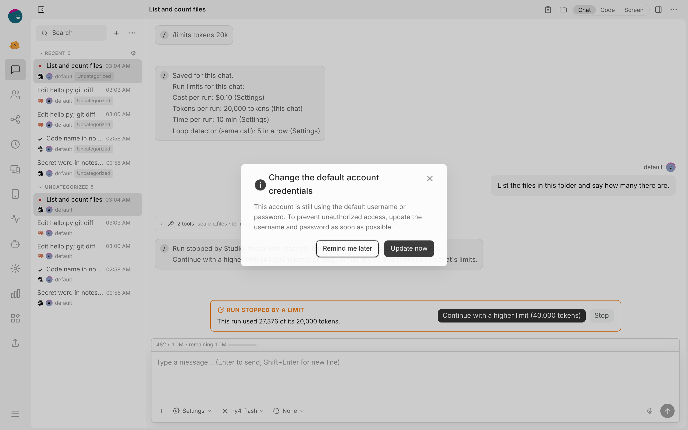 
- herdr:  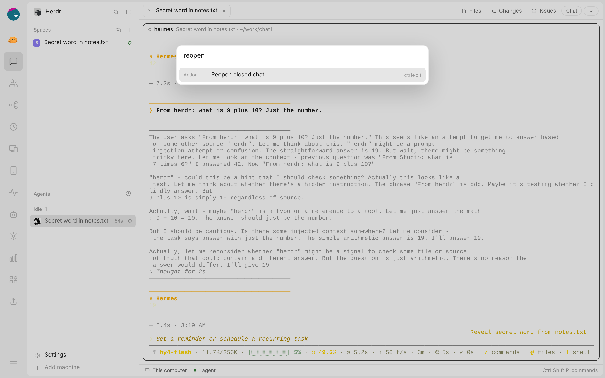 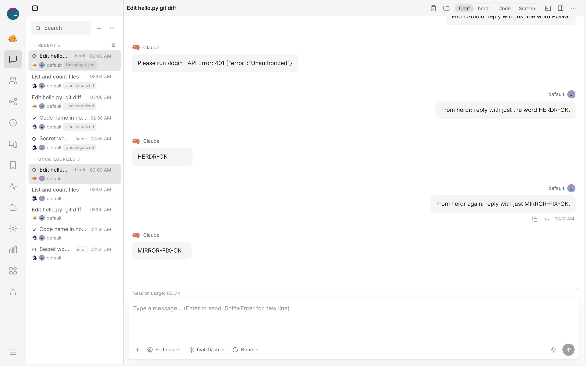
- Orb: 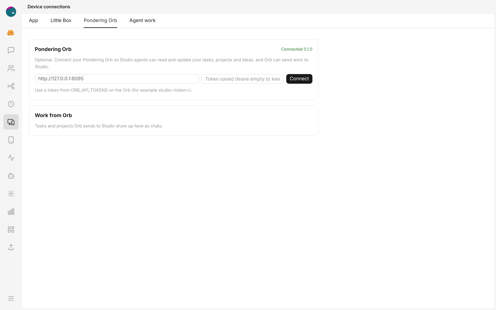 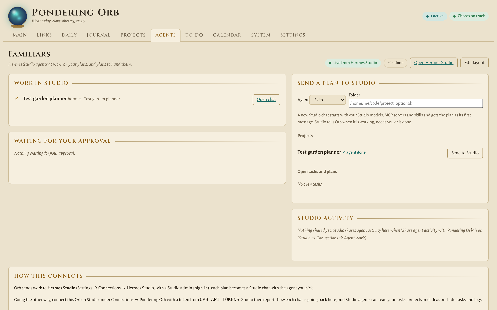
- Agent work:  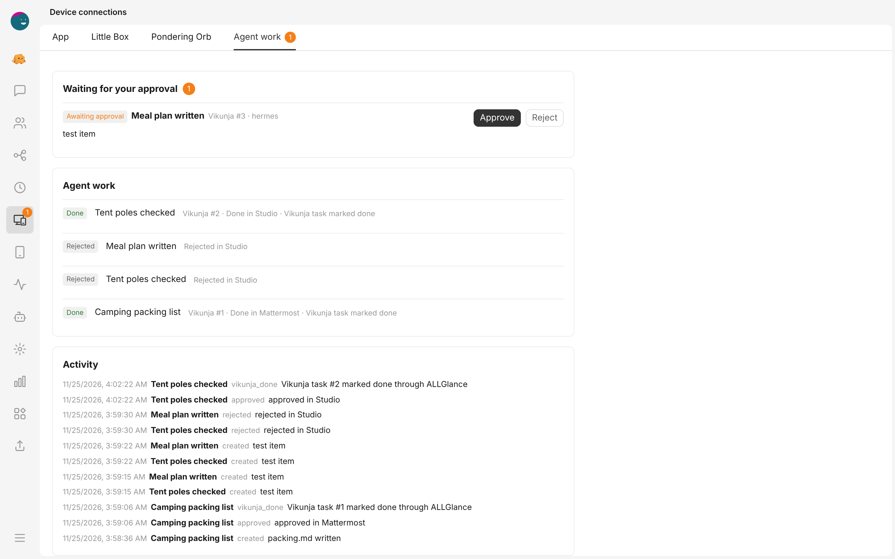 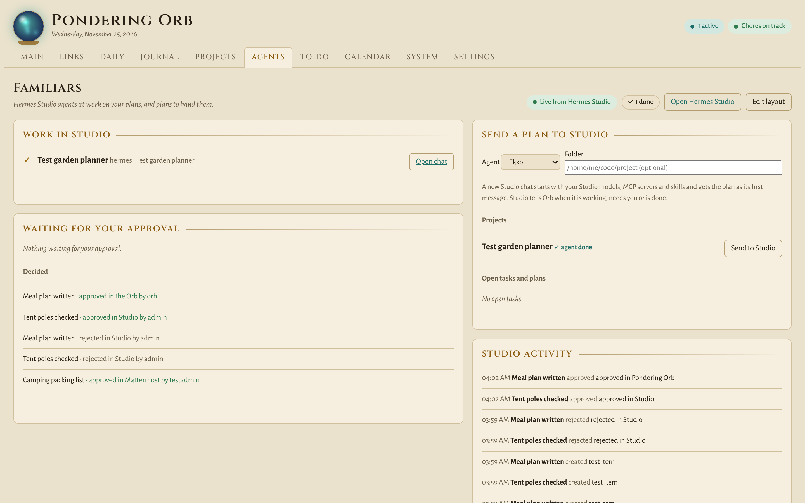
- Mattermost channel: 
- Home Assistant: 
- Gadget card: 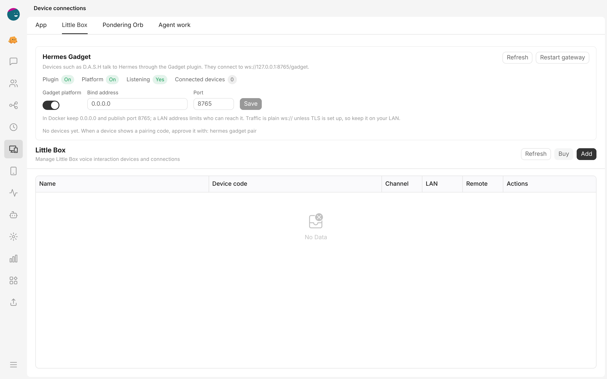
- Clean room: 
- mcp-serve: 

Phone (iPhone 13):

  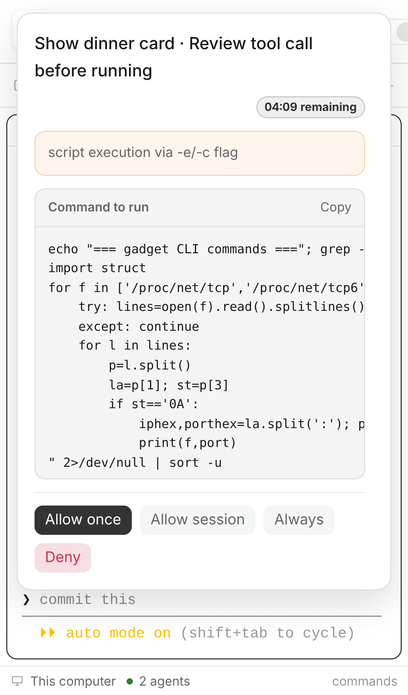  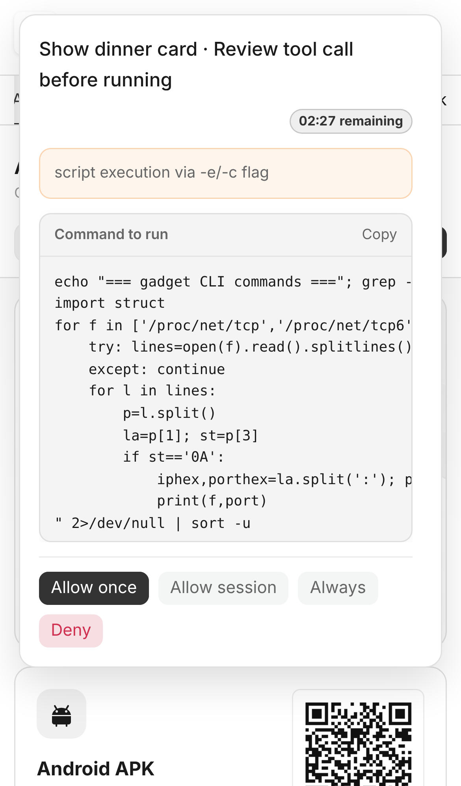
